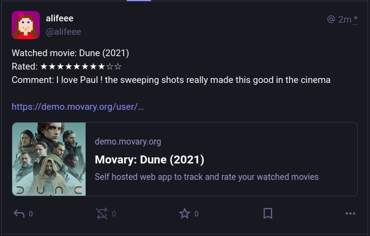
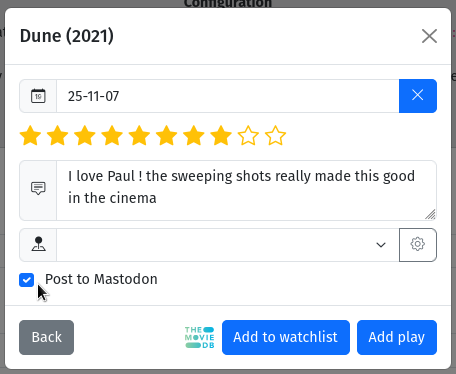

# Mastodon

The Mastodon integration can publish a status when you add a movie play or add a movie to the Movary watchlist. Posting is optional for each action and uses the visibility selected in the integration settings.



## Create a Mastodon application

Create the application on the same Mastodon server as your account. For example, an account named `@username@example.social` should use `https://example.social/settings/applications`.

1. Create a new application in the Mastodon settings.
2. Set the redirect URI to `urn:ietf:wg:oauth:2.0:oob`.
3. Grant the application the `write:statuses` scope.
4. Save the application and copy its access token.

The token can publish statuses as your account. Keep it private and revoke it from Mastodon if it is exposed or no longer needed.

## Configure Movary

1. Open **Settings → Integrations → Mastodon**.
2. Enable the integration.
3. Enter the full account name, such as `@username@example.social`, and the access token from that server.
4. Choose the default post visibility.
5. Optionally enable **Check "Post to Mastodon" by default for new plays**.
6. Select **Test** to publish a private test status with the values currently in the form.
7. Select **Save**.

The test is a real private Mastodon status. It verifies the current form values but does not save them.

When adding a play or adding a movie to the watchlist, use **Post to Mastodon** to publish that action. Posts are queued for background processing. The default checkbox setting also applies when the same add-movie dialog is used for a watchlist addition.



A play post contains the movie title, release year, and Movary movie URL. It also includes the Movary rating and play comment when present. A watchlist post contains the title, release year, and movie URL. Configure Movary with a public HTTPS `APPLICATION_URL` so Mastodon can render those links correctly.

## Post from the command line

Administrators can publish posts directly for testing or automation:

```shell
php bin/console.php mastodon:post:play --userId=1 --movieId=1 --watchDate=today
php bin/console.php mastodon:post:watchlist --userId=1 --movieId=1
```

The user must already have valid Mastodon settings saved in Movary. For a play post, `--watchDate` accepts `today` or a date in `Y-m-d` format; omit it when no specific history entry is needed for the optional comment.
